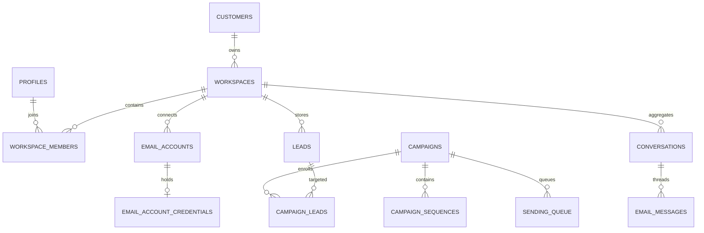

# Database Schema Documentation: EMMIL Outreach SaaS

## 1. High-Level Entity-Relationship Structure

## 2. Table Specifications

### Core Multi-Tenant
- `profiles`: Extends Supabase `auth.users`, handles system superadmin status, full name, avatar.
- `customers`: Billing tenant entity tied to subscriptions.
- `workspaces`: The root boundary for all data isolation (`workspace_id`). Contains sending defaults, schedule hours, tracking preferences.
- `workspace_members`: User memberships with roles: `owner`, `admin`, `campaign_manager`, `member`.
- `workspace_invitations`: Team invite tokens with 7-day expiration.

### Mail Infrastructure
- `email_accounts`: Connected inboxes (Gmail, M365, Zoho, custom IMAP/SMTP). Tracks daily send limit and sent counter.
- `email_account_credentials`: Encrypted secrets (AES-256-GCM), never exposed to client browsers.
- `email_sync_states`: Tracks IMAP `last_uid` and delta sync progress.
- `email_folders`: Cached mail folder statistics.

### Leads & Lists
- `leads`: Workspace contact leads with validation status, custom JSON fields, bounce/unsubscribe flags.
- `lead_lists`: Segmented lists of leads.
- `lead_list_members`: Many-to-many junction between lists and leads.

### Campaigns & Automated Sequences
- `campaigns`: Outreach campaign definitions, schedule windows, stopping conditions.
- `campaign_sequences`: Multi-step email delays (Day 0, Day 2, Day 4, etc.) with personalized body templates.
- `campaign_leads`: Lead progression tracker per sequence step.
- `campaign_step_executions`: Log of each individual step send attempt.

### Unibox (Unified Inbox)
- `conversations`: Grouped email threads by `message_id`, `in_reply_to`, and `references`.
- `email_messages`: Complete raw email payload (subject, html, text, headers).
- `email_events`: Granular logs for opens, clicks, deliveries, bounces, replies.

### Dispatch Queue & Safety
- `sending_queue`: BullMQ-backed scheduled sending jobs with retry counters.
- `suppression_list`: Global blacklist per workspace of unsubscribed and bounced contacts.
- `campaign_analytics`: Aggregated daily metrics for fast dashboard rendering.
- `subscriptions`: Stripe/billing limits (max accounts, max leads, monthly credits).
- `audit_logs`: Immutable security audit trail for compliance.
